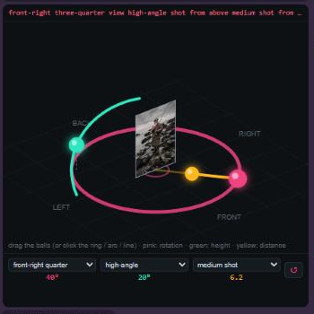
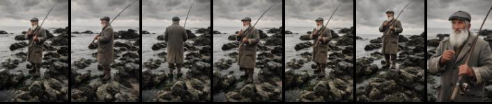

# Fibo Camera Angles for ComfyUI

An interactive 3D camera control for **Bria Fibo 2.0 Edit**. Drag the camera around your subject and the node writes a plain-language camera instruction that Fibo 2.0 Edit follows: rotate around the person, move the camera up or down, and frame wider or closer.



| Ball | Moves along | Controls |
|---|---|---|
| 🔴 Pink | the ring | **Rotation** around the subject (front, ¾, side, back) |
| 🟢 Green | the arc | **Height** of the camera (low angle … eye level … high angle) |
| 🟡 Yellow | the line | **Distance** (wide shot … waist up … face close-up) |

You can also click directly on the ring, the arc or the line, use the mouse wheel to zoom, or pick a preset from the three menus. ↺ resets to a front, eye-level shot. When an image is connected, your photo shows on the card in the middle.

## Example

Same photo, edited with Fibo 2.0 edit turbo (4 steps) and the node's instructions:



*Original · left profile (−90°) · back (180°) · front-right ¾ (45°) · high angle · low angle · close-up*

Fibo follows **rotation** and **framing** very well. Height works best with strong values (High / Low / Bird).

## Installation

**ComfyUI Manager:** search for *Fibo Camera Angles* (once listed), or

**Manual:**
```
cd ComfyUI/custom_nodes
git clone https://github.com/edvlos/ComfyUI-FiboCameraAngles
```
Restart ComfyUI. No extra Python dependencies.

You also need a ComfyUI version with Fibo 2.0 support (`TextEncodeFibo2`) and the Fibo 2.0 models:

| File | Folder |
|---|---|
| `fibo2_edit_turbo_int8_convrot.safetensors` (or bf16) | `models/diffusion_models` |
| `qwen3vl_4b_int8_convrot.safetensors` (or bf16) | `models/text_encoders` |
| `flux2-vae.safetensors` | `models/vae` |

Download: [Comfy-Org/Fibo-2.0 on Hugging Face](https://huggingface.co/Comfy-Org/Fibo-2.0)

## Usage

Load the workflow from `example_workflows/Fibo2_Camera_Angles.json` (it also shows up in ComfyUI's workflow templates for this pack):

```
Load Image ──► Fibo Camera Angles ──► TextEncodeFibo2 (prompt) ──► KSampler (4 steps, CFG 1) ──► VAE Decode ──► Save
     └───────────────────────────────► TextEncodeFibo2 (image 1)
```

### Node inputs

| Input | What it does |
|---|---|
| `horizontal_angle` | 0 = front, +90 = camera moves to the right, 180 = behind, −90 = left |
| `vertical_angle` | 0 = eye level, + = camera above looking down, − = camera below looking up |
| `zoom` | 0 = extreme wide … 5 = full body … 10 = extreme close-up |
| `subject` | How to call the subject: *the man*, *the woman*, *the car*… |
| `subject_is_person` | Uses body framing (waist up, face) for people; turn off for objects |
| `keep` | What must stay the same |
| `image` (optional) | Only used to show your photo in the 3D view |
| `extra` (optional) | Text appended to the prompt |

Outputs: `prompt` (connect to TextEncodeFibo2) and `camera_info` (JSON with the values).

Example output for 28°, −15°, zoom 5.8:

> Change the camera angle: orbit the camera 28 degrees to the right around the woman and lower the camera 15 degrees below the woman's eye level, showing the woman in a front-right three-quarter view, low-angle shot from below, the camera close to the ground looking up at the subject, more sky visible behind, medium shot from the waist up. Keep the same person, face, hair, clothing, lighting and environment; only the camera viewpoint changes.

### Tips
- If the result looks like the original, increase the angle or change the seed.
- Angles are relative to the original camera, not to the subject.
- Fibo 2.0 is licensed **CC BY-NC 4.0** (non-commercial). This node itself is MIT.

---

## Português

Controle de câmera 3D para o **Fibo 2.0 Edit** no ComfyUI. Arraste as bolinhas e o nó escreve a instrução de câmera para o Fibo:

- 🔴 **rosa (círculo):** gira a câmera em volta da pessoa
- 🟢 **verde (arco):** sobe ou desce a câmera
- 🟡 **amarela (reta):** aproxima ou afasta

Também dá para clicar direto no círculo, no arco ou na reta, usar a rodinha do mouse e os menus de ângulos prontos.

**Instalação:** `git clone https://github.com/edvlos/ComfyUI-FiboCameraAngles` dentro de `ComfyUI/custom_nodes` e reinicie o ComfyUI. O workflow de exemplo está em `example_workflows`.

**Dicas:** o Fibo obedece bem a giro e enquadramento; altura funciona melhor com valores fortes. Se ficar igual à foto, aumente o ângulo ou troque a seed. O Fibo 2.0 tem licença CC BY-NC 4.0 (uso não comercial); este nó é MIT.
